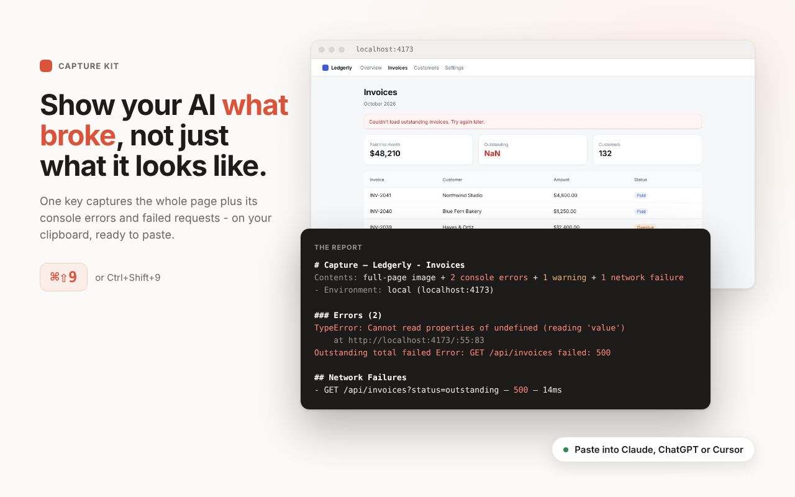

# Capture Kit

**Full-page screenshots and clips your AI can actually read, with the console
errors and failed requests behind them.**

Press one key on any page. Capture Kit takes the whole page, top to bottom,
writes a short report of what went wrong on it, and puts both on your clipboard.
Paste into Claude, ChatGPT, Cursor or any other assistant and ask what's broken.



- **The whole page, not the visible part.** True full-page capture over the
  Chrome DevTools Protocol, including pages that scroll inside a panel (Notion,
  Linear, Airtable) and pages far taller than Chrome can fit in one image.
- **The why, not just the what.** Console errors and warnings, and failed
  network requests, since the page loaded, mapped back through source maps to
  your original files.
- **Made for AI to read.** A tall page is also cut into screen-sized slices so
  its text stays legible, and a context block tells the assistant whether it's
  looking at localhost or production, at what size and zoom.
- **Clips for bugs that move.** Record a few seconds of a tab; Capture Kit keeps
  only the frames where something changed, on one sheet, with the console and
  network timeline alongside.
- **Private.** No server, no account, no analytics. Everything stays on your
  computer. Common secret formats are blanked out of reports.

Free and open source (MIT).

## Install

**Chrome Web Store:** coming soon.

**From a release** (works today):

1. Download the latest `capture-kit-vX.Y.Z.zip` from
   [Releases](https://github.com/adamsemien/capture-kit/releases) and unzip it.
2. Open `chrome://extensions` and turn on **Developer mode** (top right).
3. Click **Load unpacked** and pick the unzipped folder.

A getting-started page opens once installed. Needs Chrome 116 or later. Other
Chromium browsers should work but aren't tested yet.

## Use it

| Do this | You get |
|---|---|
| **⌘⇧9** (Ctrl+Shift+9 on Windows and Linux) | Full-page screenshot + report, both on your clipboard and saved to disk |
| **⌘⇧8** (Ctrl+Shift+8) | A clip: a few seconds of the tab, cut to the frames that changed |
| Click the toolbar icon | The panel: image only, multi-tab session capture, a 3-width responsive sweep, copy last report |

After each capture a result tab opens with the image and three buttons: **Copy
image**, **Copy report**, and **Copy image + report** (⌘⇧C). Some chats keep
only the image from a combined paste; if that happens, paste the report on its
own with Copy report.

Shortcut taken by another app? Change it at `chrome://extensions/shortcuts`.

## What's in a report

Every capture writes an image and a markdown report side by side. The report
starts with a context block - URL, local or deployed, viewport, page and image
size, zoom, what triggered the capture - and then:

- **Console** errors and warnings (and logs, if you turn them on) since page
  load, with stack frames mapped to your original source files when the page
  publishes source maps.
- **Network failures**, split into your own requests and third-party ones
  (ads, analytics, telemetry), so a blocked tracking pixel doesn't read as your
  bug.
- **Slices** for tall pages (below).

Values that look like secrets - API keys, access tokens, auth headers, JWTs -
are replaced with `[REDACTED]` in the report text before it is saved. The
screenshot shows whatever was on screen, so check it before sharing.

## Tall pages

Assistants shrink a tall image until its text can't be read: a 1280 × 30,000
capture reaches a chat as a strip about 70 px wide. So any page taller than
about two screens is also saved as **full-size, screen-sized slices** in a
`_slices` folder beside the image, overlapping slightly so no line of text is
only ever seen cut in half. Empty side margins are trimmed off each slice, so
the text stays as large as possible. The report lists the slices in order.

Pages past Chrome's 32,767 px single-image limit are no longer cut off: the
whole-page image is scaled down to fit, and the slices stay full size.

## For AI coding agents

**Let your agent read captures from disk.** In **Settings → Output folder**,
pick a folder. Every capture also overwrites `latest.md` and `latest.jpg` there,
so you can tell your agent once:

> When I say "check my capture", read `<folder>/latest.md` and the image next
> to it, then act on what you see.

**Let your agent take captures itself.** Extension shortcuts can't be pressed by
automation, so a page can fire one instead:

```js
document.addEventListener('capture-kit:capture-complete', (e) => console.log(e.detail));
document.dispatchEvent(new CustomEvent('capture-kit:capture')); // or 'capture-kit:record' for a clip
// → { ok: true, basename: "localhost-3000_2026-10-17_12-11", output: "chosen" }
```

That brings the tab to the front and writes a file, so **Settings → Automation**
decides which pages may do it:

| Mode | Who can fire a capture |
|---|---|
| **Off** (default) | No page. A page that tries gets `{ ok: false, error: "in-page trigger is turned off in Settings" }`. |
| **Allowed sites** | Only hosts you list. `localhost` and `127.0.0.1` are pre-filled. `localhost:3000` allows one port, `*.example.com` a domain and its subdomains. |
| **Any page** | Every site you visit, including ones you don't trust. |

A refused page is always told why, so an agent can tell "refused" from "broken".
A clip started this way still needs one shortcut press or icon click in that
tab first - that's a Chrome rule for recording a tab.

### Agent bridge: captures straight into Claude Code, Cursor or any MCP client

The `bridge/` folder holds a small helper that runs on your computer. Capture
Kit hands it each report as you capture, and your agent reads them through an
MCP server or the `ck` command - no folder to point at, no copy and paste.

**Set it up once** (Node 20 or later):

```sh
cd bridge && npm install && npm link   # puts ck and capture-kit-mcp on your PATH
ck pair                                # copies the pairing code to your clipboard
```

Then in **Settings → Agent bridge**, turn the bridge on, paste the code and
press **Save**. The status line should say **Connected**. Any `ck` command or
the MCP server starts the helper; Capture Kit retries every minute, so the
order doesn't matter.

**Add it to your agent** - for Claude Code:

```sh
claude mcp add capture-kit -- capture-kit-mcp
```

Other MCP clients take the same command (`capture-kit-mcp`, no arguments).

| MCP tool | `ck` command | What it does |
|---|---|---|
| `get_latest_capture` | `ck latest` | The newest report, with its image (and the "what changed" image when there is one) |
| `wait_for_capture` | `ck wait` | Waits for your next capture - "take a screenshot when it looks wrong" |
| `list_captures` / `get_capture` | `ck list` / `ck show <id>` | The last 20 captures |
| `capture_tab` | `ck capture <url part> [--scroll]` | Takes a capture itself, on a tab you allowed |
| `list_tabs` | `ck tabs` | The open tabs an agent is allowed to capture |

Every kind of capture is handed over: a responsive sweep arrives as one
capture with each width beside it, a clip with its frame sheet, and each page
of a session as its own capture. Add `--json` to any `ck` command for
machine-readable output.

**What an agent can do is up to you.** With the bridge on, the helper receives
the captures *you* take. Letting an agent *take* captures is a separate
setting, **Agent captures**, off by default, with the same Off / Allowed sites
/ Any page choices as the table above. An agent capture brings its tab to the
front, like a page-fired one. A refused request says why.

The helper listens on `127.0.0.1` only. It refuses a browser page outright,
refuses Capture Kit without the pairing code, and refuses `ck` and the MCP
server unless they read the code from `~/.capture-kit/bridge.json`, a file only
you can read. Captures are kept in `~/.capture-kit/captures/`, the newest 20.
`ck stop` stops the helper. For a new pairing code, run `ck stop`, delete
`~/.capture-kit/bridge.json`, then `ck pair` and paste the new code.

## Output folder

Chrome's downloads API can only write inside Downloads, so captures land in
`Downloads/capture-kit/` by default. Pick any folder in **Settings → Output
folder** and Capture Kit writes there directly instead. Choose **"Allow on every
visit"** when Chrome asks, and the folder keeps working across restarts. If the
permission ever lapses, captures fall back to Downloads and the result tab
offers a one-click **Reconnect**.

## Session capture and responsive sweep

- **Capture session** picks tabs across your windows and captures them one by
  one into a single folder with an `index.md` triage list - pages with errors
  first. Chrome only paints the tab in front, so the browser visibly switches
  to each tab in turn.
- **Responsive sweep** captures the current page at 375, 768 and 1440 px wide,
  with one report covering all three.

## Settings

Output folder, which pages may trigger a capture, one-click toolbar icon, URL
and time stamped onto the image, automatic copy after capture, image format
(JPEG or PNG), whether logs are included, clip length and delay, segment size,
the result tab, and the `latest.*` files. Everything that changes what a capture
does on its own is off by default.

## Known limits

- **DevTools open blocks capture.** Chrome allows one debugger per tab; close
  DevTools and try again.
- **Protected pages** - `chrome://` pages and the Chrome Web Store - can't be
  captured.
- **Virtualized lists** (long Notion databases, virtual tables) only render the
  rows on screen, so the rest come out as placeholders.
- **Canvas apps** (Figma, Google Sheets) draw to a canvas, so only what's on
  screen is captured.
- **Download-manager extensions** can rename the files; the result tab says
  when that happened.

## Permissions and privacy

Capture Kit makes no network requests of its own and has no server.
[PERMISSIONS.md](PERMISSIONS.md) explains every permission it asks for, and
[PRIVACY.md](PRIVACY.md) is the privacy policy.

## Development

```
npm install
npm run typecheck   # tsc --noEmit
npm test            # unit tests (no browser)
npm run build       # esbuild → dist/, then Load unpacked from chrome://extensions
node scripts/acceptance.mjs   # end-to-end in Chrome for Testing (CHROME_BIN to point elsewhere)
```

No runtime dependencies. Issues and pull requests are welcome.

## License

MIT - see [LICENSE](LICENSE). Includes code adapted from
[BrowserTools MCP](https://github.com/AgentDeskAI/browser-tools-mcp), see
[THIRD_PARTY_NOTICES.md](THIRD_PARTY_NOTICES.md).
